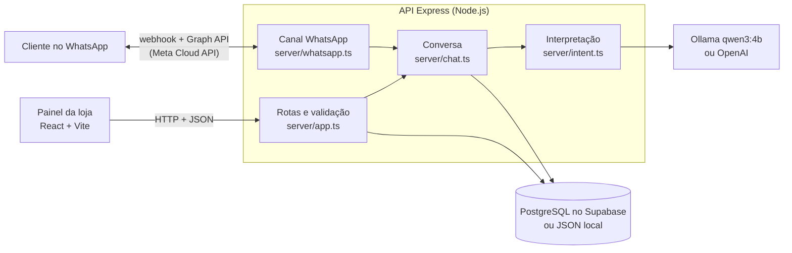
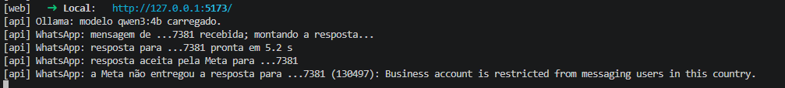

# Autoagenda

**Assistente de agendamento com inteligência artificial para estéticas automotivas, oferecido como SaaS.**

O cliente da loja escreve pelo WhatsApp em linguagem natural ("quero deixar o carro brilhando sexta à tarde"). O assistente entende o pedido, consulta a agenda real da loja, oferece horários livres com preço e previsão de entrega e reserva o horário após a confirmação do cliente. A loja acompanha tudo em um painel web.

| Item                 | Detalhe                                                                                                                                                                     |
| -------------------- | --------------------------------------------------------------------------------------------------------------------------------------------------------------------------- |
| **Integrantes**      | Diogo Correa Sela, Luiz Felipe Barbosa, Hugo Santana Raphael                                                                                                                |
| **Tipo de projeto**  | MVP de SaaS (trabalho prático)                                                                                                                                              |
| **Stack**            | TypeScript, React 19, Vite, Node.js, Express 5, Zod, Supabase (PostgreSQL), Ollama                                                                                          |
| **Canal do cliente** | WhatsApp pela API oficial da Meta (Cloud API, webhook em `server/whatsapp.ts`) e Simulador de WhatsApp no painel                                                            |
| **Testes**           | 84 testes automatizados (Vitest), todos passando                                                                                                                            |
| **Documentação**     | [`docs/Autoagenda-documentacao.pdf`](docs/Autoagenda-documentacao.pdf), [`docs/whatsapp-setup.md`](docs/whatsapp-setup.md) e [`docs/auditoria-ux.md`](docs/auditoria-ux.md) |

## Sumário

1. [Problema e público-alvo](#1-problema-e-público-alvo)
2. [Funcionalidades](#2-funcionalidades)
3. [Como executar](#3-como-executar)
4. [Roteiro de teste em 3 minutos](#4-roteiro-de-teste-em-3-minutos)
5. [Arquitetura](#5-arquitetura)
6. [Tecnologias](#6-tecnologias)
7. [Estrutura de pastas](#7-estrutura-de-pastas)
8. [API](#8-api)
9. [Técnicas aplicadas](#9-técnicas-aplicadas)
10. [Testes](#10-testes)
11. [Segurança e dados](#11-segurança-e-dados)
12. [Modelo de negócio](#12-modelo-de-negócio)
13. [Uso de IA no desenvolvimento](#13-uso-de-ia-no-desenvolvimento)
14. [Limitações e próximos passos](#14-limitações-e-próximos-passos)

## 1. Problema e público-alvo

**Problema.** Pequenas estéticas automotivas agendam pelo WhatsApp, à mão. O dono interrompe o serviço para responder preço e horário, perde clientes que escrevem fora do expediente e corre o risco de marcar dois carros no mesmo horário. Como a loja atende um veículo por vez e cada serviço dura horas, um erro de agenda custa um dia de trabalho.

**Público-alvo.** Donos de estéticas automotivas pequenas (1 a 3 funcionários), que hoje controlam a agenda em papel, planilha ou na própria conversa do WhatsApp. O cliente final, dono do veículo, só conversa com o assistente.

**Solução.** A loja cadastra serviços, preços, durações e horários no painel. O assistente atende os clientes, tira dúvidas e reserva horários reais. A IA apenas interpreta o texto do cliente: preço, disponibilidade e a confirmação da reserva são sempre decididos pelo servidor e pelo banco de dados.

## 2. Funcionalidades

### Atendimento ao cliente (assistente)

- **Entende pedidos em linguagem natural**: serviço, dia e período, inclusive correções ("na verdade prefiro lavagem"), negações e datas relativas ("sexta", "semana que vem", "na outra quarta", "uma semana depois").
- **Oferece horários reais** com preço, horário de entrada e entrega prevista; o cliente escolhe por número ("2"), ordem ("o segundo") ou horário ("às 13h").
- **Conduz a reserva até o fim**: pede nome e veículo, mostra o resumo e só reserva depois de um "sim". "Não" volta às opções; "cancelar" desiste.
- **Responde dúvidas** ("como funciona a lavagem?", "aceitam Pix?") usando apenas o catálogo e as informações cadastradas pela loja.
- **Lista os dias disponíveis** ("quais dias têm horário para polimento?") e, quando um dia está lotado, oferece outro período ou o próximo dia com vaga.
- **Não inventa dados**: preços, dias de funcionamento e disponibilidade citados pela IA são conferidos pelo servidor e substituídos pelos dados reais quando divergem.

### Painel da loja

- **Agenda da semana** com contagem de reservas por dia, próximo atendimento, valor previsto, concluir e cancelar; atualização automática a cada 30 segundos.
- **Novo agendamento manual** para clientes que ligam ou chegam à loja, usando os mesmos horários livres do assistente.
- **Catálogo de serviços**: nome, descrição (usada pelo assistente para explicar o serviço), preço, duração e ativação.
- **Regras de atendimento**: dias, abertura e fechamento, intervalo entre entradas, antecedência mínima, horizonte de reservas, aviso de variação de preço e informações extras (endereço, formas de pagamento).
- **Atendimento no WhatsApp**: o cliente conversa com o assistente pelo WhatsApp (API oficial da Meta); o telefone da reserva vem do próprio número, sem ser perguntado. Passo a passo de teste em [`docs/whatsapp-setup.md`](docs/whatsapp-setup.md).
- **Simulador de WhatsApp**: ferramenta de teste que simula um cliente escrevendo para a loja, com a mesma lógica de conversa que atende o WhatsApp.

## 3. Como executar

### Pré-requisitos

- **Node.js 22.12+** (ou 20.19+) e npm
- **Ollama** (opcional, para a IA local): https://ollama.com

### Passo a passo (Windows PowerShell)

```powershell
git clone https://github.com/diogosella/autoagenda.git
cd autoagenda
npm install
Copy-Item .env.example .env      # no Linux/macOS: cp .env.example .env
```

Para usar a IA local, baixe o modelo e defina o provedor no `.env`:

```powershell
ollama pull qwen3:4b
```

```dotenv
AI_PROVIDER=ollama
```

Inicie o sistema:

```powershell
npm run dev
```

Abra **http://127.0.0.1:5173**. A API roda em http://127.0.0.1:3001. Nenhuma conta, Docker ou chave de API é necessária: sem Supabase configurado, os dados ficam em `.data/demo.json` com quatro serviços de exemplo.

> Sem o Ollama, deixe `AI_PROVIDER` vazio: o assistente funciona em modo por regras (palavras-chave), com entendimento mais limitado. Para recomeçar com a agenda vazia, pare o servidor e apague `.data/demo.json`.

### Scripts

| Comando         | O que faz                                                 |
| --------------- | --------------------------------------------------------- |
| `npm run dev`   | API (com recarga automática) e interface juntas           |
| `npm test`      | Executa os 84 testes automatizados                        |
| `npm run build` | Verifica os tipos e gera a interface em `dist/`           |
| `npm start`     | Serve API e interface compiladas em http://127.0.0.1:3001 |

### Variáveis de ambiente (`.env`)

| Variável                                                                       | Obrigatória | Descrição                                                                                                   |
| ------------------------------------------------------------------------------ | ----------- | ----------------------------------------------------------------------------------------------------------- |
| `PORT`                                                                         | não         | Porta da API (padrão 3001)                                                                                  |
| `AI_PROVIDER`                                                                  | não         | `ollama` (IA local), `demo` (só regras) ou vazio (OpenAI se houver `OPENAI_API_KEY`; senão, regras)         |
| `OLLAMA_BASE_URL` / `OLLAMA_MODEL`                                             | não         | Endereço e modelo do Ollama (padrão `http://127.0.0.1:11434`, `qwen3:4b`)                                   |
| `WHATSAPP_VERIFY_TOKEN` / `WHATSAPP_ACCESS_TOKEN` / `WHATSAPP_PHONE_NUMBER_ID` | não         | Ligam o atendimento pelo WhatsApp (Meta Cloud API); veja [`docs/whatsapp-setup.md`](docs/whatsapp-setup.md) |
| `WHATSAPP_APP_SECRET`                                                          | não         | Chave secreta do app da Meta, usada para conferir a assinatura de cada mensagem                             |
| `OPENAI_API_KEY` / `OPENAI_MODEL`                                              | não         | Alternativa ao Ollama (padrão `gpt-4o-mini`)                                                                |
| `SUPABASE_URL` / `SUPABASE_ANON_KEY` / `SUPABASE_SERVICE_ROLE_KEY`             | não         | As três juntas ativam o banco Supabase e o login do dono da loja                                            |
| `SHOP_ID`                                                                      | não         | Loja atendida por esta instância                                                                            |

O `.env` nunca vai para o repositório (está no `.gitignore`). Chaves privadas não devem ter o prefixo `VITE_`.

### Banco Supabase (opcional)

Com Docker e o Supabase CLI:

```powershell
supabase start
supabase db reset     # recria o banco LOCAL com as migrações e o seed
supabase status       # mostra URL e chaves para o .env
```

Em um projeto Supabase remoto, execute no SQL Editor `supabase/migrations/202611210001_initial.sql`, `supabase/migrations/202611210002_settings.sql` e `supabase/seed.sql`. Depois crie um usuário em Auth e vincule-o à loja:

```sql
insert into public.shop_members(shop_id, user_id)
values ('10000000-0000-4000-8000-000000000001', 'UUID-DO-USUARIO');
```

Com Supabase ativo, o painel exige login por e-mail e senha.

## 4. Roteiro de teste em 3 minutos

1. Abra **WhatsApp** no menu lateral. No Simulador de WhatsApp, envie:
   `oi, queria deixar meu carro brilhando de novo, tem horário quinta à tarde?`
   O assistente entende **Polimento geral** sem a palavra "polimento" e lista horários reais com preço e entrega prevista.
2. Pergunte `qual a diferença pra proteção de pintura?`: a resposta usa só o catálogo e inclui o aviso de variação de preço.
3. Responda `2`, depois `joão da silva`, depois `Civic prata`. Confira o resumo e envie `sim`.
4. Abra **Agenda e serviços**: a reserva aparece na quinta, com a contagem na faixa da semana.
5. Clique em **Nova conversa** e envie `vocês fazem pintura?`: o assistente informa que o serviço não existe e lista os serviços reais.
6. Envie `quais dias disponiveis para polimento`: o assistente lista os próximos dias com horário livre.
7. Em **Agenda e serviços**, clique em **Novo agendamento**: o horário reservado no passo 3 não aparece mais como livre.

## 5. Arquitetura



| Camada                    | Responsabilidade                                                                                                                                         | Onde                           |
| ------------------------- | -------------------------------------------------------------------------------------------------------------------------------------------------------- | ------------------------------ |
| **Interface**             | Painel da loja: agenda, catálogo, regras e Simulador de WhatsApp. Não contém regras de negócio; toda ação é uma chamada à API.                           | `src/`                         |
| **Lógica**                | Rotas e validação (`app.ts`); etapas da conversa e cálculo de horários livres (`chat.ts`); interpretação com IA e conferência da resposta (`intent.ts`). | `server/`                      |
| **Domínio compartilhado** | Tipos, esquemas Zod, cálculo de horários, fuso de Brasília e regras de atendimento, usados pela interface e pela API.                                    | `shared/`                      |
| **Armazenamento**         | PostgreSQL (Supabase) em produção ou arquivo JSON na demonstração, com o mesmo contrato de acesso.                                                       | `server/store.ts`, `supabase/` |

**Princípio central: "a IA entende, o sistema decide".** O modelo devolve apenas um JSON com serviço, data, período e, para perguntas, uma explicação. O servidor confere tudo antes de usar e é o único que calcula horários, preços e grava reservas. Isso torna seguro usar um modelo pequeno, que às vezes erra.

**Fluxo de uma mensagem:** o cliente escreve → `chat.ts` verifica em que etapa a reserva está → se precisar entender linguagem natural, `intent.ts` consulta a IA e valida a resposta → `chat.ts` calcula os horários livres na agenda → a resposta volta com dados reais → no "sim", a reserva é gravada com nova validação de disponibilidade.

## 6. Tecnologias

| Tecnologia            | Uso                  | Motivo da escolha                                               |
| --------------------- | -------------------- | --------------------------------------------------------------- |
| TypeScript            | Todo o projeto       | Tipos compartilhados entre interface e servidor                 |
| React 19 + Vite       | Painel da loja       | Componentes reutilizáveis e recarga instantânea                 |
| Node.js + Express 5   | API REST             | Leve, mesma linguagem da interface, fácil de testar             |
| Zod                   | Validação            | Um esquema valida formulários, requisições e respostas da IA    |
| Supabase (PostgreSQL) | Banco e autenticação | Login pronto, RLS e restrições de integridade no banco          |
| Ollama (qwen3:4b)     | IA local             | Sem custo por mensagem e sem enviar dados de clientes para fora |
| OpenAI (opcional)     | IA na nuvem          | Mesma interface do Ollama, trocada por variável de ambiente     |
| Vitest                | Testes               | Rápido e integrado ao Vite                                      |

## 7. Estrutura de pastas

```text
autoagenda/
├── src/                    Interface React
│   ├── App.tsx             Agenda, catálogo, novo agendamento, login
│   ├── Workspace.tsx       Layout, Simulador de WhatsApp, menu
│   └── RulesEditor.tsx     Regras de atendimento
├── server/                 API Express
│   ├── app.ts              Rotas, autenticação, validação, limites
│   ├── chat.ts             Etapas da conversa e da reserva
│   ├── intent.ts           Interpretação (IA ou regras) e conferência
│   ├── whatsapp.ts         Canal WhatsApp: webhook da Meta e envio de respostas
│   ├── store.ts            Acesso a dados: JSON local ou Supabase
│   └── index.ts            Inicialização e aquecimento do Ollama
├── shared/                 Domínio compartilhado (tipos, Zod, horários)
├── supabase/               Migrações SQL, seed e configuração local
├── tests/                  84 testes automatizados (Vitest)
└── docs/                   Documentação em PDF, guia do WhatsApp e auditoria de UX
```

## 8. API

| Método e rota                     | Acesso  | Descrição                                             |
| --------------------------------- | ------- | ----------------------------------------------------- |
| `GET /api/config`                 | público | Modo de dados, provedor de IA e loja                  |
| `GET /api/services`               | público | Serviços ativos                                       |
| `GET /api/availability`           | público | Horários livres de um serviço em uma data             |
| `POST /api/bookings`              | público | Cria reserva com validação completa                   |
| `POST /api/interpret`             | público | Interpreta um pedido em texto                         |
| `GET /api/whatsapp/webhook`       | Meta    | Verificação do webhook (token de verificação)         |
| `POST /api/whatsapp/webhook`      | Meta    | Mensagens do cliente (assinatura HMAC conferida)      |
| `POST /api/owner/chat`            | dono    | Mensagem do Simulador de WhatsApp (etapas da reserva) |
| `GET /api/owner`                  | dono    | Serviços e reservas                                   |
| `POST /api/owner/services`        | dono    | Cria ou edita serviço                                 |
| `PATCH /api/owner/bookings/:id`   | dono    | Conclui ou cancela reserva                            |
| `GET` / `PUT /api/owner/settings` | dono    | Lê e salva as regras de atendimento                   |

## 9. Técnicas aplicadas

| Técnica                          | Onde aparece                                                                                                     |
| -------------------------------- | ---------------------------------------------------------------------------------------------------------------- |
| Arquitetura em camadas           | Interface, lógica e dados separados; a interface nunca acessa banco ou IA                                        |
| API REST com JSON                | `server/app.ts`                                                                                                  |
| Validação nos dois lados         | Esquemas Zod em `shared/` + função SQL `book_service` no banco                                                   |
| Integridade no banco             | `EXCLUDE USING gist` impede reservas sobrepostas, mesmo simultâneas                                              |
| Controle de acesso               | RLS no Supabase; cada dono acessa só a própria loja                                                              |
| IA com saída estruturada         | JSON Schema obrigatório + conferência de serviço, data, preço e dias                                             |
| Máquina de estados               | `server/chat.ts`: pedido → horário → nome → veículo → confirmação → reservado                                    |
| Testes automatizados             | 84 testes, incluindo conversas completas até a reserva, também pelo WhatsApp                                     |
| Auditoria de UX e acessibilidade | WCAG 2.2 e heurísticas de Nielsen, com medições antes e depois em [`docs/auditoria-ux.md`](docs/auditoria-ux.md) |
| Design responsivo                | Painel verificado em 1366×768 (notebook) e 390×844 (celular)                                                     |

## 10. Testes

```powershell
npm test
```

| Arquivo                                          | Cobre                                                                                                           |
| ------------------------------------------------ | --------------------------------------------------------------------------------------------------------------- |
| `scheduling.test.ts`                             | Horários livres, expediente, sobreposição, datas relativas                                                      |
| `chat-booking.test.ts`                           | Conversas completas até a reserva, telefone, dia lotado, dias disponíveis                                       |
| `intent-ai.test.ts`                              | Respostas simuladas da IA: códigos, preços e dias inventados, datas passadas                                    |
| `chat-regressions.test.ts`                       | Correções, negações e mudanças de ideia no meio da conversa                                                     |
| `api.test.ts`                                    | Rotas HTTP, reservas simultâneas (só uma é aceita), cotação desatualizada, regras salvas, origens bloqueadas    |
| `conversation.test.ts`                           | Contexto mantido quando o cliente responde só a data ou troca o serviço                                         |
| `settings.test.ts`                               | Regras personalizadas: domingo aberto, antecedência, horizonte, horários inválidos                              |
| `ollama.test.ts`, `unsupported-services.test.ts` | Chamada ao Ollama e pedidos de serviços que a loja não oferece                                                  |
| `whatsapp.test.ts`                               | Webhook da Meta: verificação, assinatura, reserva completa, conversas separadas, mensagens repetidas, 9º dígito |

## 11. Segurança e dados

- Nenhuma senha ou chave está no código; `.env` e `.data/` estão no `.gitignore`.
- A chave `service_role` do Supabase é usada só no servidor; RLS habilitado em todas as tabelas.
- A API valida tamanho e formato de toda entrada, restringe origens do navegador e limita requisições de escrita por IP.
- Com o Ollama, a interpretação das mensagens acontece na máquina da loja.
- Webhook do WhatsApp: cada mensagem tem a assinatura da Meta (`X-Hub-Signature-256`) conferida com a chave secreta do app; pelo túnel, só essa rota é acessível.
- Dados guardados por reserva: nome, telefone e veículo do cliente, além do preço e da duração confirmados.

## 12. Modelo de negócio

Assinatura mensal por loja; cada loja tem conta, catálogo e agenda próprios (o banco já separa os dados por `shop_id`).

| Plano      | Inclui                                                                                           | Preço sugerido |
| ---------- | ------------------------------------------------------------------------------------------------ | -------------- |
| Agenda     | Painel, agenda, catálogo e agendamento manual                                                    | R$ 79/mês      |
| Assistente | Tudo do Agenda + atendimento automático no WhatsApp com IA (limite mensal de mensagens incluído) | R$ 199/mês     |

14 dias grátis. Um único polimento (R$ 650) paga mais de três meses do plano Assistente. Valores propostos pelo grupo para o trabalho.

## 13. Uso de IA no desenvolvimento

A definição da ideia e do público-alvo foi feita pelo grupo, sem IA. ChatGPT, Codex (OpenAI) e Claude (Anthropic) ajudaram na programação, nos testes, na investigação de erros, na auditoria de UX e na documentação. Toda sugestão foi testada antes de ser aceita.

Exemplos concretos:

- A revisão de código feita com IA encontrou o bug em que "uma semana depois" apagava a data correta entendida pelo modelo; o caso virou teste.
- O modelo local exibia IDs internos do banco para o cliente; a correção passou a enviar códigos curtos (S1, S2) ao modelo e a bloquear no servidor qualquer resposta com IDs.
- O modelo inventava dias de funcionamento; o servidor passou a conferir dias, horários e disponibilidade com as regras da loja.
- No teste com o WhatsApp real, a resposta não chegava ao celular; os registros de cada etapa sugeridos pela IA mostraram que a Meta aceitava o envio e bloqueava a entrega por regra de país (erro 130497).

Detalhes na seção 8 de [`docs/Autoagenda-documentacao.pdf`](docs/Autoagenda-documentacao.pdf).

## 14. Limitações e próximos passos

**Limitações atuais**

- O WhatsApp foi testado com a Meta real usando o número de teste gratuito, que é americano (+1 555). A mensagem do cliente chega, a IA responde em cerca de 5 s e a Meta aceita o envio, mas a entrega para números +55 é bloqueada pela política antifraude da Meta para mensagens de outros países ao Brasil (erro 130497). Em produção, cada loja conecta o próprio número brasileiro de WhatsApp Business e o bloqueio não se aplica; o código não muda, só o `.env`. Na demonstração, o atendimento é mostrado no Simulador de WhatsApp.

  

- No modo de demonstração (JSON), execute uma única instância da API; para várias instâncias, use o Supabase.
- Preço e duração são únicos por serviço; o aviso ao cliente informa que o valor pode variar conforme o porte e o estado do veículo.
- O sistema roda localmente (servidores escutam só em 127.0.0.1); a publicação na internet não faz parte deste MVP.

**Próximos passos**

1. Número brasileiro próprio da loja no WhatsApp Business, com token permanente (libera a entrega para clientes +55).
2. Preço e duração por porte do veículo, com a IA classificando o modelo do carro.
3. Histórico de conversas no painel e transferência para um atendente humano.
4. Publicação na internet, cadastro de novas lojas e cobrança da assinatura.
5. IA hospedada em produção: Qwen3 32B em um provedor compatível com a API da OpenAI (por exemplo, Groq), com custo estimado em cerca de US$ 0,50 por mil mensagens. O Ollama fica para o desenvolvimento; se o provedor cair, o assistente usa o modo por regras. Nome e telefone do cliente são ocultados antes do envio, e cada plano tem um limite mensal de mensagens.
