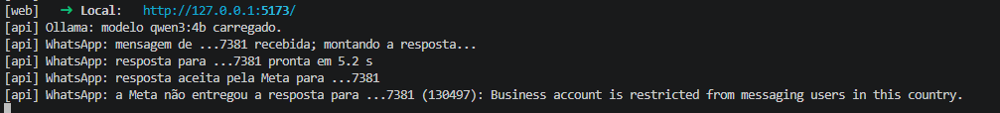

# Testar o Autoagenda no seu WhatsApp

Este guia conecta o assistente ao número de teste gratuito da Meta (WhatsApp Cloud API). Você manda mensagens do seu WhatsApp pessoal para esse número e recebe as respostas do assistente, que consulta e grava a agenda do painel.

Tempo estimado: 20 minutos. Custo: zero. Não precisa de cartão nem de CNPJ: o número de teste aceita até 5 destinatários cadastrados.

## Como funciona

```text
Seu WhatsApp ──► Meta ──► túnel (cloudflared) ──► API local :3001 ──► chat.ts ──► agenda
     ▲                                                     │
     └──────────── Meta ◄── Graph API (resposta) ◄─────────┘
```

A API continua escutando só em 127.0.0.1. O túnel expõe a porta para a Meta, e a API aceita pelo túnel **somente** a rota `/api/whatsapp/webhook`; o painel e as demais rotas respondem 404 para quem vem de fora.

## 1. Criar o app na Meta

1. Acesse <https://developers.facebook.com> e entre com sua conta do Facebook. Na primeira vez, aceite os termos de desenvolvedor.
2. Clique em **Meus apps > Criar app**. Escolha o caso de uso **Conectar-se com clientes pelo WhatsApp** (ou o tipo **Empresa**) e conclua.
3. No painel do app, abra **WhatsApp > Configuração da API** (API Setup). A Meta já cria um **número de teste**.

## 2. Cadastrar o seu número como destinatário

1. Ainda em **Configuração da API**, no campo **Para** (To), clique em **Gerenciar lista de números**.
2. Adicione o seu celular com DDI e DDD (ex.: +55 11 98888-7777).
3. A Meta envia um código pelo WhatsApp; digite-o para confirmar.

Os colegas do grupo que quiserem testar também precisam ser cadastrados aqui (até 5 números).

## 3. Copiar as credenciais para o `.env`

Na mesma tela de **Configuração da API**:

| Onde está na Meta                                          | Variável no `.env`         |
| ---------------------------------------------------------- | -------------------------- |
| **Token de acesso temporário** (botão Gerar)               | `WHATSAPP_ACCESS_TOKEN`    |
| **ID do número de telefone** (Phone number ID)             | `WHATSAPP_PHONE_NUMBER_ID` |
| **Configurações do app > Básico > Chave secreta do app**   | `WHATSAPP_APP_SECRET`      |
| Um texto qualquer criado por você (ex.: `autoagenda-2026`) | `WHATSAPP_VERIFY_TOKEN`    |

O `.env` fica assim (os valores são seus; nunca os coloque no código nem no GitHub):

```env
WHATSAPP_VERIFY_TOKEN=autoagenda-2026
WHATSAPP_ACCESS_TOKEN=EAAG...
WHATSAPP_PHONE_NUMBER_ID=1234567890
WHATSAPP_APP_SECRET=abc123...
WHATSAPP_GRAPH_VERSION=v25.0
```

O token temporário vale cerca de 24 horas. Quando expirar, gere outro na mesma tela, troque no `.env` e reinicie o `npm run dev`.

## 4. Subir o projeto e o túnel

Em um terminal:

```powershell
npm run dev
```

O terminal deve mostrar `WhatsApp: ativo; webhook em /api/whatsapp/webhook`.

Em outro terminal, instale o cloudflared uma vez e abra o túnel:

```powershell
winget install --id Cloudflare.cloudflared
cloudflared tunnel --url http://127.0.0.1:3001
```

Ele mostra um endereço como `https://palavras-aleatorias.trycloudflare.com`. Deixe esse terminal aberto. O endereço muda a cada vez que o túnel reinicia; nesse caso, repita o passo 5.

## 5. Ligar o webhook na Meta

1. No painel do app, abra **WhatsApp > Configuração** (Configuration).
2. Em **Webhook**, clique em **Editar** e preencha:
   - **URL de retorno de chamada**: `https://palavras-aleatorias.trycloudflare.com/api/whatsapp/webhook`
   - **Token de verificação**: o mesmo valor de `WHATSAPP_VERIFY_TOKEN`
3. Clique em **Verificar e salvar**. A Meta chama a API; se o token bater, a configuração é aceita.
4. Em **Campos do webhook**, clique em **Gerenciar** e assine o campo **messages**.

## 6. Testar

Do seu WhatsApp, mande uma mensagem para o número de teste (ele aparece na tela de Configuração da API). Exemplos:

1. `oi, quanto custa um polimento?`
2. `quero uma lavagem sexta à tarde`
3. Escolha um horário, informe nome e veículo e responda `sim`.

O telefone não é perguntado: o assistente usa o número do próprio WhatsApp. A reserva aparece na agenda do painel em até 30 segundos. Cada número tem a sua conversa; depois de 24 horas sem mensagens, a conversa recomeça do zero.

## Problemas comuns

| Sintoma                                                 | Causa e solução                                                                                                                                                     |
| ------------------------------------------------------- | ------------------------------------------------------------------------------------------------------------------------------------------------------------------- |
| A Meta não aceita a URL ao clicar em Verificar e salvar | O `npm run dev` ou o túnel não estão rodando, a URL não termina em `/api/whatsapp/webhook`, ou o token de verificação é diferente do `.env`.                        |
| A mensagem chega (aparece lida) mas não há resposta     | Veja o terminal da API. Código **131030**: seu número não está na lista de destinatários (passo 2). Código **190**: o token expirou (passo 3).                      |
| Nada aparece no terminal quando você manda mensagem     | O campo **messages** não foi assinado (passo 5.4) ou o endereço do túnel mudou.                                                                                     |
| `assinatura inválida; mensagem descartada` no terminal  | `WHATSAPP_APP_SECRET` não confere com a chave secreta do app.                                                                                                       |
| `a Meta não entregou a resposta … (130497)` no terminal | Política da Meta: o número de teste é americano e números estrangeiros não podem enviar para o Brasil. Use um número brasileiro próprio (Step 5, Add phone number). |
| A resposta demora                                       | Na primeira mensagem o Ollama carrega o modelo; as seguintes são mais rápidas. A Meta recebe a confirmação na hora e a resposta é enviada em seguida.               |

## O que foi implementado

| Parte                                                                                     | Arquivo                                                 |
| ----------------------------------------------------------------------------------------- | ------------------------------------------------------- |
| Verificação do webhook e assinatura                                                       | `server/app.ts`, `server/whatsapp.ts`                   |
| Conversa por telefone (histórico e etapa)                                                 | `server/store.ts`, migração `202611220003_whatsapp.sql` |
| Envio pela Graph API, com nova tentativa para números brasileiros com ou sem o 9º dígito  | `server/whatsapp.ts`                                    |
| Mensagens repetidas pela Meta respondidas uma vez, e uma mensagem por cliente de cada vez | `server/whatsapp.ts`                                    |
| Testes com a Graph API simulada                                                           | `tests/whatsapp.test.ts`                                |

## Resultado do teste com a Meta (22/11/2026)

Com o número de teste, a integração completa foi executada: a mensagem chegou pelo webhook, a assinatura foi conferida, o assistente respondeu em 5,2 s e a Meta aceitou o envio. A entrega para o celular +55 foi bloqueada pela Meta com o erro 130497, porque o número de teste é dos Estados Unidos e a Meta restringe mensagens de outros países para o Brasil. Com um número brasileiro registrado no app, a conversa é dentro do país e essa restrição não se aplica.



O número de teste serve para demonstração. Para atender clientes reais, a loja precisa de uma conta do WhatsApp Business verificada, um número próprio e a publicação da API em um servidor.
